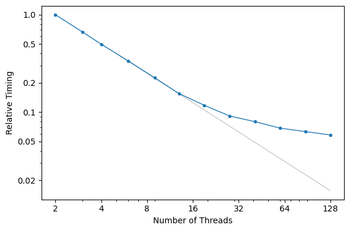

# MARS

A C++/CUDA implementation of [Multivariate Adaptive Regression Splines](https://w.wiki/GVPL),
a semi-brute-force search for interactions and non-linearities. It can deliver
regression performance competitive with neural networks, while providing inference
performance competitive with linear models.

References:

* [Write-up describing the method](https://uc-r.github.io/mars)
* [Commercial MARS package](https://www.minitab.com/en-us/solutions/analytics/statistical-analysis-predictive-analytics/mars/),
  originally from Salford Systems, now part of Minitab
* [R "earth" package documentation](https://cran.r-project.org/web/packages/earth/earth.pdf)
* [Stephen Milborrow's earth page](https://www.milbo.org/earth/)
* A scikit-learn implementation, [py-earth](https://contrib.scikit-learn.org/py-earth)

## Performance

We use [OpenMP](https://www.openmp.org) to parallelize the forward pass across
cores. By default `fit` uses every core the process can see, capped at 64. The
`threads` argument sets an explicit count. Note that `OMP_NUM_THREADS` has no
effect. Each thread carries its own scratch copy of the candidate columns (of
order *n* × *p* floats), which might limit how many cores one can use in
practice on large datasets.

The timings below were measured in July 2025 on an AMD EPYC 9654 (96 cores,
192 logical CPUs), relative to a 2-thread run. Scaling is close to ideal through
about 16 threads, still improving to 32, and flat beyond 64. The chart predates
the 2026 kernel work (see `docs/notes.md`), so absolute times have dropped since
then. We keep it to show the shape of the scaling curve.



`expand` is parallel as well: it fills the basis matrix in row blocks across
cores and returns it in Fortran order by default or C order with `order="C"`.

A CUDA build can also run the forward pass on the GPU. See
[Build instructions](#build-instructions) below.

## Supported platforms

The build has been verified on the following platforms:

* Ubuntu 18.04 through 24.04
* macOS High Sierra (10.13) through Tahoe (26.4)
* Raspbian 10

Note that the older entries used earlier versions of the `setup.py` build, and
might not work today without some tinkering.

## Build requirements

* [CMake](https://cmake.org/) ≥ 3.18
* A C++17 compiler with OpenMP support
* Python ≥ 3.10 with `numpy` and `scipy` (`mars.py` uses them at runtime)
* [pybind11](https://pybind11.readthedocs.io) ≥ 2.12
* Optional, for GPU builds only:
  * [CUDA Toolkit](https://developer.nvidia.com/cuda-toolkit) with `nvcc`
* Optional, for `make test` only:
  * [Eigen](https://libeigen.gitlab.io/) ≥ 3.3
  * [GoogleTest](https://github.com/google/googletest)
  * [pytest](https://docs.pytest.org)

```bash
# Linux: the library needs only cmake. eigen and gtest are for the tests.
sudo apt install -y cmake libeigen3-dev libgtest-dev
# macOS: libomp is for the library. eigen and googletest are for the tests.
brew install cmake libomp eigen googletest
```

`pip install .` fetches `pybind11` and `scikit-build-core` as build
dependencies, so you do not have to install them yourself. A dev build with
`make` needs `pybind11` installed where CMake can find it
(`pip install pybind11`).

On macOS, the build links `libomp` statically into `marslib.so`, so the
OpenMP runtime stays private to this extension. This prevents the
"OMP: Error #15: libomp.dylib already initialized" crash. That crash happens
when another extension (numpy, scipy, sklearn, ...) has already loaded a
different `libomp.dylib` into the Python interpreter. You do not need the
`KMP_DUPLICATE_LIB_OK=TRUE` workaround.

## Build instructions

CMake drives the build, but you do not run `cmake` yourself: `pip install .`
and `make` both configure and build in one step. The exception is a sanitizer
build, which you configure by hand as shown at the top of the `Makefile`.
`pyproject.toml` defines the package, with
[scikit-build-core](https://scikit-build-core.readthedocs.io) as the build
backend. There is no `setup.py`.

### Default build: GPU kernels when a GPU is present

`pip install .` and `make` decide at configure time whether to build the GPU
kernels into `marslib.so`. They build them in when they find both a working
CUDA compiler (`nvcc`) and an NVIDIA GPU (one that `nvidia-smi -L` lists).
Otherwise the library is CPU-only. To skip both checks and force a CPU-only
build, set `NOCUDA=1`:

```bash
cd mars
pip install .            # GPU kernels if nvcc + a GPU are found, else CPU-only
NOCUDA=1 pip install .   # CPU-only
```

pip hides the build output. To see which build the configure step chose and
why, add `-v` (`pip install -v .`) and look for the line that starts with
`CUDA:`.

For local development, the Makefile is a thin wrapper around CMake. It makes
the same decision:

```bash
cd mars
make            # configures + builds; drops marslib*.so at the source root
NOCUDA=1 make   # CPU-only
make test       # runs the C++ unit tests (+ CUDA tests on a GPU build) and pytest
make clean      # removes the build/ directory and built .so
```

CMake caches the decision in `build/`. Run `make clean` before you switch
between a CPU-only and a GPU build.

The tests always import `mars.py` and `marslib*.so` from the checkout, never a
copy in site-packages. If either module resolves somewhere else,
`tests/conftest.py` stops the run. This happens, for example, when you have
not built the local `.so` yet.

### Forcing a GPU build (`USE_CUDA=ON`)

The CMake option `USE_CUDA` controls the GPU kernels. Its default is `AUTO`.
Set it to `ON` to require them. The configure step then fails if `nvcc` is
missing, instead of falling back to a CPU-only build. It also skips the GPU
check, so you can build a GPU wheel on a machine without a card. `OFF` is the
same as `NOCUDA=1`. An explicit `ON` or `OFF` overrides the `NOCUDA`
environment variable.

```bash
# wheel: pass the CMake define through pip
pip install . -C cmake.define.USE_CUDA=ON

# local dev: one-shot GPU build (run `make clean` first to switch a CPU build
# dir over, and again to switch back)
make cuda
```

A GPU build needs the CUDA Toolkit (`nvcc`). By default it targets compute
capabilities 7.5 and 12.0, and it drops any target that the installed `nvcc`
cannot emit (12.0 needs CUDA ≥ 12.8). To pin a single target, pass
`-DCMAKE_CUDA_ARCHITECTURES=<arch>` to CMake. For a wheel, append
`-C cmake.define.CMAKE_CUDA_ARCHITECTURES=<arch>` to the pip command.

To run the forward pass on the GPU, pass `cuda=True` to `mars.fit`. The GPU
then runs both the orthonormalize step and the hinge sweep. The GPU fit is not
bit-identical to the CPU fit: near-tied terms can come out in a different
order.

The module has no capability flag. To tell a CPU build from a GPU build at
runtime, call `fit(..., cuda=True)`. On a CPU-only build it raises
*"marslib was built without CUDA support (configure with -DUSE_CUDA=ON)"*.

## Example

Here we train a linear model with a categorical interaction.

```python
import numpy as np
X      = np.random.randn(10000, 2)
X[:,1] = np.random.binomial(1, .5, size=len(X))
y      = 2*X[:,0] + 3*X[:,1] + X[:,0]*X[:,1] + np.random.randn(len(X))

# convert to column-major float
X = np.array(X, order='F', dtype='f')
y = np.array(y, dtype='f')

# Fit the model
import mars
model = mars.fit(X, y, max_terms=17, tail_span=0, linear_only=True)
B     = mars.expand(X, model)          # expand the basis
model["beta"] = mars.prune(B, y)       # backward pass: GCV pruning, stores the coefficients
y_hat = B @ model["beta"]

# Pretty-print the model
mars.pprint(model)
```

Depending on the random seed, the output should look similar to this:

```
    -0.0157
     +2.005 * X[0]
     +3.004 * X[1]
     +1.004 * X[0] * X[1]
```

`prune` sets the coefficient of each term it drops to zero. To get a smaller
model without those terms, call `mars.compact(model)`.
