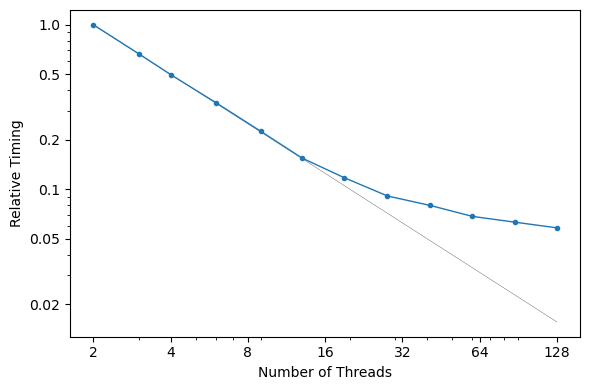

# MARS

A C++/CUDA implementation of [Multivariate Adaptive Regression Splines](https://w.wiki/GVPL),
a semi-brute-force search for interactions and non-linearities. It can deliver
regression performance competitive with neural networks, while providing inference
performance competitive with linear models.

References:

* [Write-up describing the method](https://uc-r.github.io/mars)
* [Commercial MARS package](https://www.minitab.com/en-us/solutions/analytics/statistical-analysis-predictive-analytics/mars/),
  originally from Salford Systems, now part of Minitab
* [R "earth" package documentation](https://cran.r-project.org/web/packages/earth/earth.pdf)
* [Stephen Milborrow's earth page](https://www.milbo.org/earth/)
* A scikit-learn implementation, [py-earth](https://contrib.scikit-learn.org/py-earth)

## Performance

We use [OpenMP](https://www.openmp.org) to parallelize the forward pass across
cores. By default `fit` uses every core the process can see, capped at 64; the
`threads` argument sets an explicit count. `OMP_NUM_THREADS` has no effect,
since the binding sizes its thread team explicitly. Each thread carries its
own scratch copy of the candidate columns (of order *n* × *p* floats), which can
limit how many cores one can use in practice on large datasets.

The timings below were measured in July 2025 on an AMD EPYC 9654 (96 cores,
192 logical CPUs), relative to a 2-thread run. Scaling is close to ideal through
about 16 threads, still improving to 32, and flat beyond 64. The chart predates
the 2026 kernel work (see `CLAUDE.md`), so absolute times have dropped since; it
is kept for the shape of the scaling curve.



A CUDA build can additionally run the `linear_only` forward pass on the GPU;
see the GPU build section below.

## Supported Platforms

The build has been verified on the following platforms:

* Ubuntu 18.04 through 24.04
* macOS High Sierra (10.13) through Tahoe (26.4)
* Raspbian 10

The older entries in that list date from the earlier `setup.py` build. Their
stock toolchains fall below the CMake and Python minimums in the next section
(Ubuntu 20.04 ships CMake 3.16 and Python 3.8, for instance), so on those
releases expect to supply a newer CMake and Python yourself.

## Build Requirements

* [CMake](https://cmake.org/) ≥ 3.18
* A C++17 compiler with OpenMP support
* Python ≥ 3.10 with `numpy` and `scipy` (used at runtime by `mars.py`)
* [pybind11](https://pybind11.readthedocs.io) ≥ 2.12 — `pip install .` fetches
  it automatically; a dev build via `make` needs it visible to CMake
  (`pip install pybind11`)
* *optional* — GPU builds only:
  * [CUDA Toolkit](https://developer.nvidia.com/cuda-toolkit) with `nvcc`
* *optional* — `make test` only:
  * [Eigen](https://libeigen.gitlab.io/) ≥ 3.3
  * [GoogleTest](https://github.com/google/googletest)
  * [pytest](https://docs.pytest.org)

```bash
# Linux — library needs only cmake; eigen + gtest are for the tests:
sudo apt install -y cmake libeigen3-dev libgtest-dev
# macOS — libomp is for the library; eigen + googletest are for the tests:
brew install cmake libomp eigen googletest
```

`pip install .` pulls `pybind11` and `scikit-build-core` automatically as build
dependencies — no need to install them by hand.

On macOS, `libomp` is statically linked into `marslib.so` so the OpenMP
runtime stays private to this extension. This avoids the "OMP: Error #15:
libomp.dylib already initialized" crash that fires whenever the Python
interpreter already loaded a different `libomp.dylib` via another extension
(numpy/scipy/sklearn/...). No `KMP_DUPLICATE_LIB_OK=TRUE` workaround needed.

## Build Instructions

CMake drives the build — you never invoke `cmake` by hand (except for the
sanitizer builds noted at the top of the `Makefile`). Both `pip install .` and
`make` configure *and* build for you. Packaging is driven by `pyproject.toml`
via the [scikit-build-core](https://scikit-build-core.readthedocs.io) backend;
there is no `setup.py`.

### CPU build (default)

A plain `pip install .` or `make` produces a CPU-only library.

```bash
cd mars
pip install .
```

For local development, the Makefile is a thin wrapper around CMake:

```bash
cd mars
make            # configures + builds; drops marslib*.so at the source root
make test       # runs the C++ unit tests (+ CUDA tests on a GPU build) and pytest
make clean      # removes the build/ directory and built .so
```

The tests always import the checkout's `mars.py` and `marslib*.so`, never a
copy installed in site-packages; `tests/conftest.py` fails the run if either
resolves elsewhere (for example when the local `.so` has not been built yet).

### GPU build (opt-in, CUDA)

The GPU orthonormalize kernels are gated behind the `USE_CUDA` option,
which is disabled by default. Turn it on to build them into `marslib.so`:

```bash
# wheel: pass the CMake define through pip
pip install . -C cmake.define.USE_CUDA=ON

# local dev: one-shot GPU build (run `make clean` first to switch a CPU build
# dir over, and again to switch back)
make cuda
```

A GPU build additionally needs the CUDA Toolkit (`nvcc`). It targets compute
capabilities 7.5 and 12.0 by default; pin a single target with
`-DCMAKE_CUDA_ARCHITECTURES=<arch>` (append
`-C cmake.define.CMAKE_CUDA_ARCHITECTURES=<arch>` to the pip command).

Pass `cuda=True` to `mars.fit` to run the forward pass's orthonormalize step on
the device. Only the `linear_only` search is batched onto the GPU; the hinge
sweep stays on the CPU, so the gain is largest in the `linear_only` regime. The
module exposes no capability flag, so the only way to tell a CPU and a GPU
build apart at runtime is behavioral: `fit(..., cuda=True)` on a CPU-only build
raises *"marslib was built without CUDA support (configure with -DUSE_CUDA=ON)"*.

## An Example

Here we train a linear model with a categorical interaction.

```python
import numpy as np
X      = np.random.randn(10000, 2)
X[:,1] = np.random.binomial(1, .5, size=len(X))
y      = 2*X[:,0] + 3*X[:,1] + X[:,0]*X[:,1] + np.random.randn(len(X))

# convert to column-major float
X = np.array(X, order='F', dtype='f')
y = np.array(y, dtype='f')

# Fit the model
import mars
model = mars.fit(X, y, max_terms=17, tail_span=0, linear_only=True)
B     = mars.expand(X, model)          # expand the basis
model["beta"] = mars.prune(B, y)       # backward pass: GCV pruning, stores the coefficients
y_hat = B @ model["beta"]

# Pretty-print the model
mars.pprint(model)
```

`prune` zeroes the coefficient of every term it drops; `mars.compact(model)`
returns a smaller model with those terms removed. Depending on the random seed,
the result should look similar to this:

```
    -0.0157
     +2.005 * X[0]
     +3.004 * X[1]
     +1.004 * X[0] * X[1]
```
